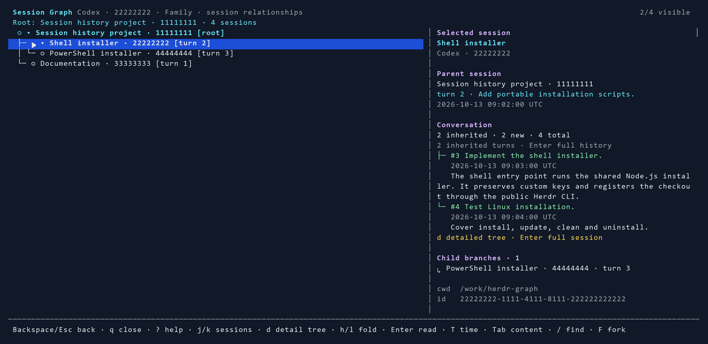
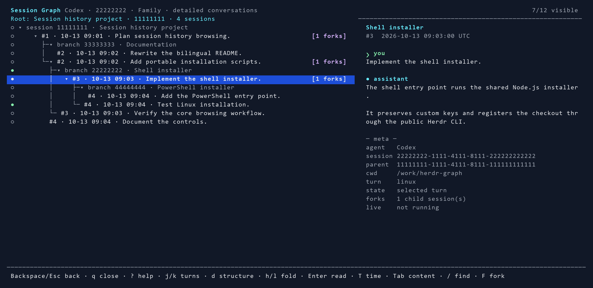
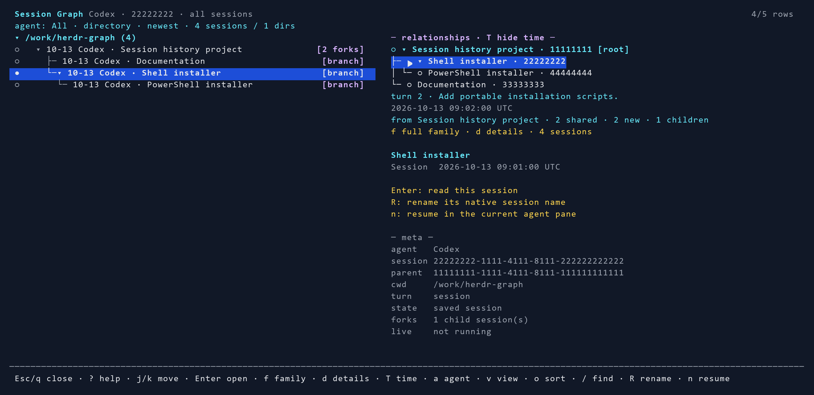

# Session Graph

[English](README.md) · [简体中文](README.zh-CN.md)

Browse and rename local Codex, Claude Code and DST sessions inside [Herdr](https://herdr.dev).



*Current interface rendered with demo data; no private conversation content.*

- Browse history by directory or time; filter Codex, Claude Code and DST sessions, including archived Codex records.
- View complete session families, fork turn numbers and detailed prompt trees.
- Search full prompts and answers with highlighted results and a scrollable reader.
- Rename native sessions; resume or fork in the agent pane that opened the plugin.

Browsing is read-only. Rename and fork use native agent storage. See [Current limitations](#current-limitations) for agent differences.

## Requirements

- [Herdr](https://herdr.dev/docs/install/) **0.9.0+** and **Node.js 18+**, both on the Herdr process's `PATH`.
- Git for cloning and updating the project.
- Local Codex, Claude Code or DST session files. DST compressed history requires **Node.js 24+**.
- Install the relevant agent CLI to resume or fork; native rename also requires the installed Codex or DST CLI. Claude rename uses its local title files.
- An interactive terminal; **100+ columns** recommended. Two-column conversation views need 72 columns and Family needs 96; narrow Family pages offer a full-width reader.

| Platform | Status |
| --- | --- |
| Windows | Runtime verified |
| Linux | Declared in manifest; code reviewed, runtime not yet verified |
| macOS | Declared in manifest; code reviewed, runtime not yet verified |

| Agent | Transcript location |
| --- | --- |
| Codex | `$CODEX_HOME/sessions` and `$CODEX_HOME/archived_sessions`; default home `~/.codex` |
| Claude Code | `$CLAUDE_CONFIG_DIR/projects`; default home `~/.claude` |
| DST / DeepSeek Harness | `$DSH_HOME/sessions`; default home `~/.dsh` |

On Windows, `~` means `%USERPROFILE%`. Session files must be accessible on the machine running the plugin.

The installer saves custom `CODEX_HOME`, `CLAUDE_CONFIG_DIR` and `DSH_HOME` values in this plugin's `session-roots.json`, so history remains discoverable if Herdr was started without those variables. The plugin process's environment takes precedence. To change a saved path, set the variable and rerun `install`. Other agents need an adapter; there is no generic transcript parser.

## Install

Start Herdr, then clone the repository and run the installer.

### Linux / macOS

```sh
git clone https://github.com/huluhuluu/herdr-graph.git
cd herdr-graph
sh ./install.sh install
```

### Windows (PowerShell)

```powershell
git clone https://github.com/huluhuluu/herdr-graph.git
cd herdr-graph
powershell -ExecutionPolicy Bypass -File .\install.ps1 install
```

The installer registers this checkout with `herdr plugin link` and adds a managed keybinding block. Keep the directory available. No `npm install`, build step, administrator access, or Herdr source changes are required.

Existing managed keys are preserved. Key changes validate UTF-8 TOML and create a backup before replacement. Failed reloads restore the original unless it has since been edited; concurrent edits are preserved and reported. Add `--no-keys` to skip config changes and open via the CLI command below.

The template binds `prefix+g` to open the graph and `prefix+shift+g` to key setup. Review [config.example.toml](config.example.toml) before setup if those keys are already in use; recent Herdr versions also use them for built-in actions.

## Update, clean and uninstall

Use the same installer for maintenance, from the checkout directory:

```sh
sh ./install.sh --help
sh ./install.sh update
sh ./install.sh clean
sh ./install.sh uninstall
```

```powershell
powershell -ExecutionPolicy Bypass -File .\install.ps1 --help
powershell -ExecutionPolicy Bypass -File .\install.ps1 update
powershell -ExecutionPolicy Bypass -File .\install.ps1 clean
powershell -ExecutionPolicy Bypass -File .\install.ps1 uninstall
```

| Command | Effect |
| --- | --- |
| `install` (default) | Register and enable this checkout; add keys if no managed block exists |
| `install --no-keys` | Register and enable this checkout without editing Herdr config |
| `update` | Run `git pull --ff-only`, refresh registration and clear parse caches; preserve keys and enabled status |
| `clean` | Delete only this plugin's parse caches and cache temporary files |
| `uninstall` | Remove its managed key block, unlink the plugin and clear parse caches; keep the checkout |
| `setup-keys` | Explicitly replace managed keys with `config.example.toml` |
| `remove-keys` | Remove only the managed key block |
| `--help` | Show commands and options |

Close graph panes before updating or cleaning. Updates require a clean Git checkout on a branch with an upstream; local changes and diverged branches are preserved and cause an error. Reopen the graph after updating. Installation, updates and uninstallation require a running Herdr server.

Cleanup never deletes agent transcripts, other plugins, repository files or config backups. `HERDR_PLUGIN_STATE_DIR` overrides the cache directory; otherwise it uses Herdr's state path under `XDG_STATE_HOME` / `~/.local/state` or Windows `%LOCALAPPDATA%`. Cleanup also covers the old direct-CLI cache location.

## Use

1. Focus an agent pane in Herdr, or open the plugin to browse saved history.
2. Press `prefix+g`. With Herdr's default prefix, press **Ctrl+B**, release, then **G** without Shift.
3. Press `s` for saved sessions, grouped by directory. Press `Enter` to expand a directory, then read a session. Use `a` to filter agents, `v` for a time list, `o` to reverse the sort order and `/` to search. Missing current-session IDs automatically open history.
4. Move with `j/k`; press `Tab` to focus and scroll the content. In an ordinary conversation, `Enter` on a turn focuses its running session. `n` resumes and `F` forks; see agent-specific behavior below.
5. Press `R` to rename the selected session. Use **Ctrl+U** to clear the existing name, type a name and press `Enter`; `Esc` cancels.
6. Press `f` for **Family**, then `d` to switch between session structure and detailed turns. Branches show their source `[turn N]`; select a turn to read its full question and answer. `T` toggles timestamps, `h/l` fold branches.
7. Press `Backspace` or `Esc` to return to the previous page, keeping its selection, filters, folds and scroll position. `Esc` closes at the first page; `q` closes from any page. During search or rename, `Esc` cancels editing.

You can also open it from the agent pane's shell:

```sh
herdr plugin action invoke open --plugin huluhlu.session-graph
```

| Key | Action |
| --- | --- |
| `j` / `k`, `↓` / `↑` | Move between nodes; scroll when content has focus |
| `g` / `G`, `Home` / `End` | First / last node, or top / bottom of focused content |
| `h` / `l`, `←` / `→` | Collapse / expand a directory or branch; expand a marked fork to open its family |
| `Tab` / `Shift+Tab` | Switch tree / detail focus and preserve reading position; narrow Family pages use a full-width reader |
| `PgUp` / `PgDn` | Page the focused tree in every view; scroll focused content by 10 lines |
| `Enter` | Directory: expand / collapse; session header: read; Family turn: focus reader; ordinary turn: jump to running pane |
| `s` | Show all saved sessions |
| `f` | Open the whole family under the common ancestor; repeated presses stay on that page |
| `d` | Switch Family structure / detailed conversation tree; opens Family when used elsewhere |
| `b` | Compatibility alias for `f` |
| `T` (`Shift+T`) | Hide / show relationship timestamps; keep turns and connections visible |
| `a` | Cycle agent filter: All → Codex → Claude → DST → All |
| `v` | Switch directory / time view |
| `o` | Switch newest / oldest first |
| `R` | Rename the selected session; `Ctrl+U` clears the input |
| `n` | Resume in the current Codex / Claude pane; open DST's native history picker |
| `F` (`Shift+F`) | Fork the complete saved Codex session and switch to it; branch the current Claude session; unavailable for DST |
| `t` | Cycle scope: session → lineage → all saved sessions |
| `/` | History / Family structure: search session metadata; conversation / Family detail: search full questions and answers; empty input clears |
| `K` / `?` | Key setup instructions / help; scroll help with `j/k` or `PgUp/PgDn` |
| `Backspace` | Return to the previous page; delete a character when editing |
| `Esc` | Cancel search / rename or close help; otherwise go back, or close at the first page |
| `q` | Close from any browsing page |
| `Ctrl+C` | Close from any mode, including search, rename and loading |

### Search and reading

Search selects the first actual match, highlights matching text in yellow and positions the reader at the hit. Family keeps ancestor rows for context. Press `Tab` to focus **Content**, then use `↑/↓` or `j/k` to scroll, `PgUp/PgDn` to page and `Home/End` for top/bottom. Focus changes preserve your position; `Ctrl+U` clears search or rename input.

History expands the caller's directory initially. `v` switches to a flat time list; `o` reverses transcript modification-time sorting. Agent filters combine with search and sorting. Dates are displayed in UTC.

### Family and branches

`f` shows the common ancestor and all its descendants, including sibling branches. Structure uses one row per session; the right panel lists new branch turns and summarizes inherited history. `d` shows the detailed conversation tree, displaying shared history once. It preserves the selected session when switching views. `Enter` reads a session header's full history or focuses a selected turn's content. On narrow Family pages, `Tab` opens the full-width reader and returns to the tree.



Connections follow native parent IDs. `[turn N]` refers to the direct parent's complete conversation; the displayed time belongs to that source turn, not the fork's creation or file modification time. Missing parent sessions remain visible. `[loading…]`, `[turn ?]` and read errors distinguish unfinished loading, unknown locations and failures. `T` hides/shows times across pages; `Backspace` / `Esc` returns to the previous page.

The current conversation loads first, followed by current-directory and other history entries. Family structure appears before background parsing fills in branch details. Navigation and closing remain available while loading.

### Resume and fork

Open from an idle agent pane with an empty input box to use `n` / `F`. The caller must run the same agent as the selected session. Switching uses that existing pane. Sessions reported as running elsewhere cannot be resumed here; open their conversation and press `Enter` on a turn to focus them.

Codex fork copies the complete saved conversation using native App Server `thread/fork`, then sends `/resume <new ID>` to the current Codex process. Selecting an earlier turn only changes the preview. Claude `n` uses `/resume <ID>`; `F` uses `/branch` and requires the selected session to be the current session reported by Herdr. DST `n` opens `/resume`, where you choose the session in its native picker; direct ID switching and plugin fork are unavailable.

### Native rename

| Agent | How the name is saved |
| --- | --- |
| Codex | Official App Server `thread/name/set`; visible in the native session history |
| Claude Code | Native `custom-title` record and `custom-title.json` sidecar |
| DST | Native `session/title` event through the installed persistence backend |

Rename does not start a model turn or replace conversation messages. Running clients may need to reopen or resume the session to refresh their displayed name. DST refuses rename while a writer owns the session: close its running agent before renaming. Older DST files can be browsed, but rename requires the per-session generation layout.



## Configure keys

Edit the `# session-graph begin` … `# session-graph end` block in Herdr's config:

| Platform | Default config path |
| --- | --- |
| Linux / macOS | `~/.config/herdr/config.toml` |
| Windows | `%APPDATA%\herdr\config.toml` |

`HERDR_CONFIG_PATH` overrides the file; `XDG_CONFIG_HOME` overrides the default config directory. After editing, run:

```sh
herdr server reload-config
```

Prefer editing the installed block so the Git checkout stays clean for updates. To replace it with `config.example.toml`, run:

```sh
node src/install.js setup-keys
```

`node src/install.js remove-keys` removes only the managed keys. Both actions are also available through either installer. `K` only shows instructions; it does not edit keys.

## Current limitations

- **Branch records:** only native parent/fork metadata establishes cross-session links. Matching topics do not imply a branch. Missing fork locations are marked; missing parent transcripts cannot be reconstructed. “All” remains a session catalog; `f` opens the family relationship page.
- **Forking:** Codex copies the saved session history, without a selected-turn boundary. The plugin submits the switch command; any native resume error appears in the agent pane. Claude branching requires a CLI with `/branch` support and a known current session ID.
- **Refresh and layout:** the 5-second poll updates pane status, not conversation content. Reopen to load new turns. Below 72 columns, the ordinary content column is hidden; both Family views provide a full-width reader.

If no history appears, check the agent storage paths above. With a custom agent home, rerun the installer from the shell that sets it. Check `herdr pane list` and the [Herdr integration](https://herdr.dev/docs/integrations/) if opening the current session or jumping to a running pane does not work; these operations use `agent_session.value`.

## Development

```sh
npm test
npm run bench
```

Tests cover history, branch trees, search, pane switching, native rename/fork and lifecycle operations. Native Codex/DST checks use temporary agent homes and skip when the CLI is absent. `bench` reads the three largest local Codex and Claude transcripts per agent and compares cold/warm runs in a temporary cache directory, reporting cache hits and misses. Existing sessions and plugin caches remain untouched.

See [Development notes](docs/DEVELOPMENT.md) for the module map and outstanding issues. Keep both READMEs aligned when changing commands, support status, limitations, or the preview.
